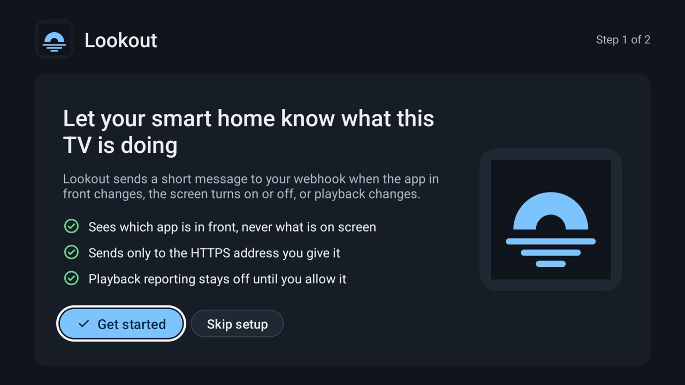
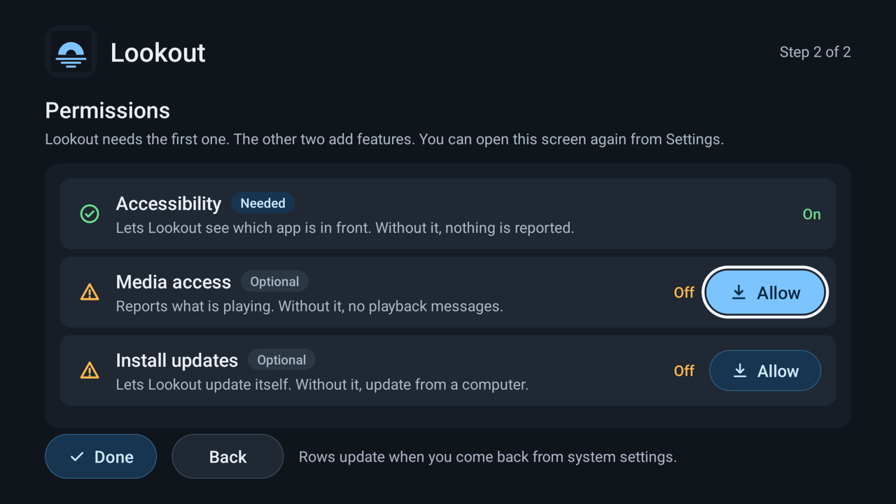
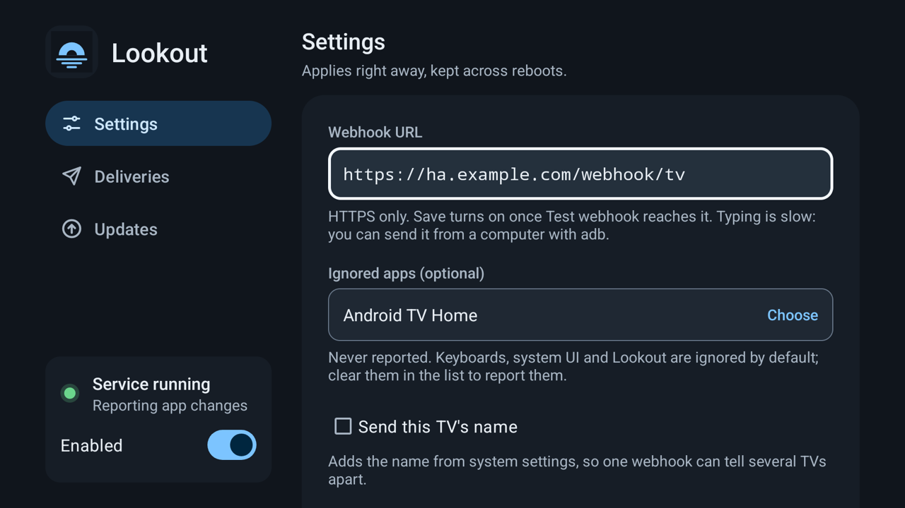
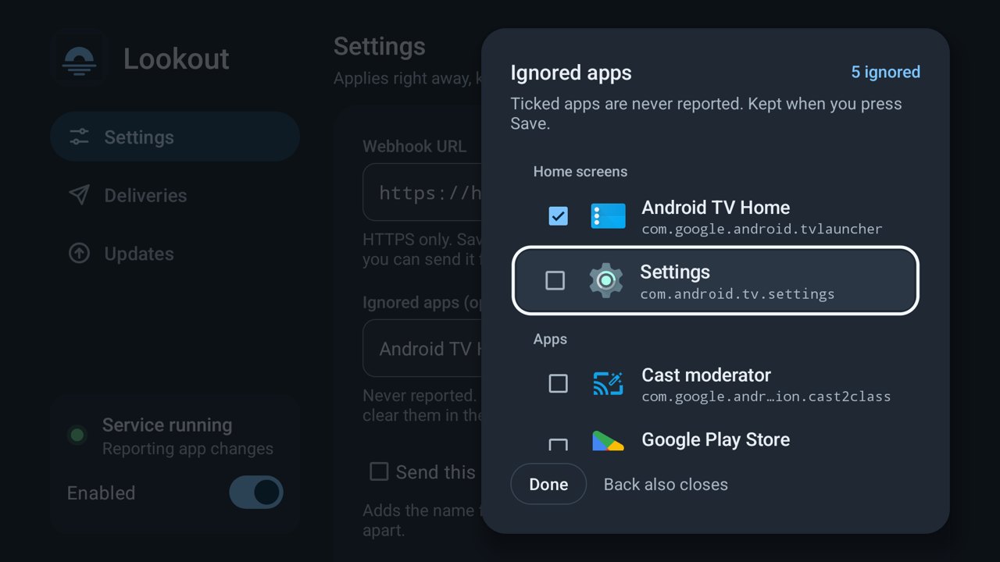
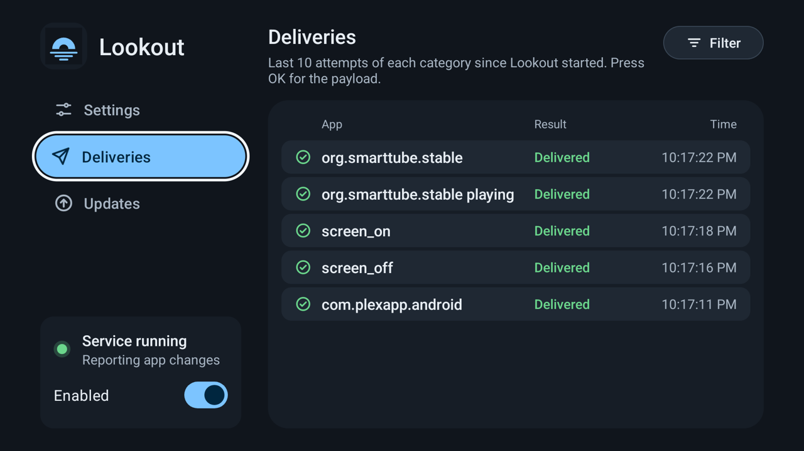
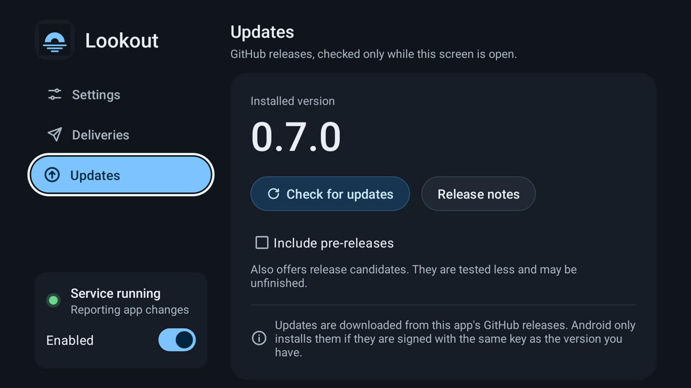

#  Lookout

**Home, meet your TV.** Lookout tells your smart home which app is open, whether the screen is on and what's playing.

## What you can do with it

- Dim the lights when playback starts and bring them back up when you pause.
- Switch the soundbar to its movie mode for Plex or Netflix, and to music for Spotify.
- Pause the kitchen speaker when the TV wakes up.
- Turn the receiver off when the screensaver starts, instead of waiting for a timer.
- Get a notification when YouTube opens after bedtime.
- Show what's on the TV on your dashboard, with the title when the app shares it.

## Why Lookout

- **Works with any app**, including sideloaded ones. There is nothing to set up per app.
- **Private by design.** It sees which app is in front, never what is on screen. Playback reporting is off until you switch it on.
- **Instant and self-healing.** Each change is pushed as it happens, and the whole TV state is sent again every 30 seconds, so a missed message fixes itself.
- **Any receiver.** Home Assistant, Node-RED, n8n or your own HTTPS server: it is a plain JSON POST.
- **Keeps itself current.** It updates from this repository's releases after checking each download's SHA-256.
- **Free and open source** under the Apache 2.0 license.

## Install

You need:

- An Android TV with Android 9 or newer.
- A computer with `adb` on the same network. Turn on **wireless debugging** on the TV first.
- A webhook address that starts with `https://`, for example from Home Assistant.

### 1. Put Lookout on the TV

1. Download the `.apk` file from [Releases](../../releases/latest).
2. On your computer, connect to the TV. Use the address and port the TV shows under wireless debugging:

   ```sh
   adb connect <tv-ip>:<port>
   ```

3. Install it:

   ```sh
   ./scripts/install.sh lookout-<version>.apk
   ```

That is all. It is safe to run again, for example after a factory reset.

### 2. Allow what Lookout needs

The first time you open **Lookout**, it shows a short setup.

1. Press **Get started**.

   

2. Press **Allow** next to **Accessibility**, turn Lookout on in the screen that opens, then press Back. If you used `install.sh`, it already says **On**.

   Android may warn that Lookout can "see" or "control" the screen. It shows this for every accessibility app, whatever it does. Lookout only asks Android which app is in front. It never asks for what is on the screen, and it cannot tap or type.

3. The other two are optional. **Media access** lets Lookout report what is playing. **Install updates** lets it update itself. Press **Allow** on each one you want.
4. Press **Done**.



Some TVs have no screen for a permission. Fire TV has none for media access. There the button says **Show command**: it shows one line to run from your computer instead.

You can open this screen again from **Settings → Permissions**.

### 3. Tell Lookout where to send things



1. Type your webhook address.
2. Press **Test webhook**. Wait until it says "Test event delivered". If it says something else, check the address.
3. Press **Save**.

Done. Lookout now sends a message whenever something changes.

Typing with the remote is slow. To fill the address in from your computer instead, run this, then press **Test webhook** and **Save** on the TV:

```sh
adb shell am start --activity-clear-top -n dev.aman.lookout/.SettingsActivity \
  --es url "https://example.com/hooks/lookout"
```

### Things you can do on the TV

- **Enabled** (under the status on the left) turns all reports off and on. Your settings stay.
- **Ignored apps** are never reported, such as your launcher. Press **Choose** and tick them.

  

  Keyboards, system UI and Lookout itself are ticked at the bottom, because they are ignored by default. Clear one to report it. Apps with no icon, such as a screensaver, are not listed. To ignore one, send it from your computer with `--es ignored "com.example.one,com.example.two"` in the command above.

- **Deliveries** shows the last 10 messages and whether they arrived. Press OK on one to see exactly what was sent. **Filter** at the top also shows heartbeats.

  

- **Updates** installs the newest version. **Release notes** shows what changed in the newest version, or in the one you have when you are up to date. Tick **Include pre-releases** to get test versions too. Lookout only talks to GitHub while this tab is open.

  

## Home Assistant example

Every message carries the TV's whole state under `tv`, so one sensor can read it from any message:

```yaml
template:
  - triggers:
      - trigger: webhook
        webhook_id: !secret lookout_webhook_id
        local_only: false
    conditions:
      - condition: template
        value_template: "{{ trigger.json.tv is defined }}"
    sensor:
      - name: TV app
        state: "{{ trigger.json.tv.app | default(this.state, true) }}"
        attributes:
          screen: "{{ trigger.json.tv.screen | default('unknown') }}"
          screensaver: "{{ trigger.json.tv.screensaver | default('unknown') }}"
          playback: "{{ trigger.json.tv.playback }}"
```

- The sensor only changes when the state does, so the heartbeat every 30 seconds adds nothing to your history.
- `tv.app` is missing after Lookout restarts, until the next app change, so the sensor keeps its last value meanwhile.
- The condition skips **Test webhook**, which sends no `tv`.
- For an automation that reacts to one change, such as dimming the lights, trigger on the sensor, or check `trigger.json.event` so it does not run on every heartbeat.

## What it sends

An accessibility service listens for window changes only. It never reads window content, so it sees which app is in front, not what is on screen. System UI, keyboards and Lookout itself are ignored unless you choose to report them. Each app change is sent as:

```json
POST <webhook url>
Content-Type: application/json

{
  "event": "app_changed",
  "tv": {
    "app": "org.smarttube.stable",
    "screen": "on",
    "screensaver": false,
    "playback": []
  },
  "device": "Living room",
  "timestamp": 1731600000,
  "id": "c0ffee00-1234-4abc-8def-0123456789ab"
}
```

- `event` names the kind of message.
- `device` is the TV's name from its system settings, so one webhook can serve several TVs. It is only sent when **Send this TV's name** is ticked.
- `timestamp` is Unix seconds.
- `tv` is the whole state of the TV after this change. Every message has it, whatever its `event`, so it is the easiest thing to read. A message never says anything twice: the other fields are only what `tv` cannot hold.
  - `app` is the last app Lookout reported, so it stays on the previous app while an ignored app, such as your launcher, is in front. It is left out after a restart until the next app change.
  - `screen` is `on` or `off`.
  - `screensaver` is `true` while the screensaver runs, and `false` once it stops or the screen turns off. It is left out until Lookout sees one of these, because Android cannot be asked.
  - `playback` lists each app that is playing or paused, with the fields described under Playback below. It is empty when nothing plays, or when **Media access** is not allowed.

Lookout also reports the TV itself, with the same `event`, `tv`, `device` and `timestamp` fields:

- `screen_on` and `screen_off`. The screen state is also sent when the service starts.
- `screensaver_started` and `screensaver_stopped`. While the screensaver runs, app changes are not reported, so the app you were using stays as the current one.

Besides window changes, Lookout only watches these screen and screensaver changes, and playback if you allow it below. It reads nothing else about the TV.

### Playback (optional)

Lookout can also report what an app is playing:

```json
{
  "event": "playback_changed",
  "tv": {
    "app": "org.smarttube.stable",
    "screen": "on",
    "screensaver": false,
    "playback": [
      {
        "package": "org.smarttube.stable",
        "state": "playing",
        "title": "Video title",
        "artist": "Channel",
        "album": "Playlist",
        "duration": 215,
        "position": 42,
        "artwork": "https://example.com/cover.jpg"
      }
    ]
  },
  "timestamp": 1731600000,
  "id": "5eed1e55-9abc-4def-8123-0123456789ab"
}
```

- `playback_changed` has no fields of its own: the change is in `tv.playback`, with one entry for each app that plays or pauses. `state` is `playing` or `paused`, and an app that stopped is no longer listed. Besides `package` and `state`, an entry has only what the app gives: `title`, `artist`, `album`, `album_artist`, `subtitle`, `description`, `genre`, `year`, `duration`, `position` and `artwork`.
- `duration` and `position` are in seconds. `position` is how far in the app was when its state or what it plays last changed. It is not updated as it moves, so a heartbeat repeats the last one.
- `artwork` is a web address. Text is cut at 200 characters.
- `device` works as above.

It is off until you allow **Media access** in setup (**Settings → Permissions**). If your TV has no screen for it, run this once from your computer instead:

```sh
adb shell cmd notification allow_listener dev.aman.lookout/dev.aman.lookout.playback.MediaAccessService
```

This gives Lookout Android's notification access, which is the only way an app may read media sessions. Lookout never reads notifications; the service it registers for this does nothing else.

Only apps that mark their media session as active are seen. SmartTube does so unless **Settings → Player → Developer options → Disable playback notifications** is ticked.

### Delivery

- Each change is sent once, as it happens. Any 2xx counts as delivered.
- A message that fails is not sent again. Instead, a heartbeat sends the TV's whole state every 30 seconds, so your smart home catches up within 30 seconds of the webhook working again.
- It also catches up at once when the TV's network comes back, when you save a new webhook address and when you switch **Enabled** back on.
- Nothing is saved for later, so a restart or a reboot loses nothing either: the first heartbeat goes out as soon as Lookout starts.
- Redirects are not followed, so use the final URL.
- `id` is also sent as the `webhook-id` header. Each message has its own.

### Heartbeat

Every 30 seconds, Lookout sends the TV's state again, so your smart home always has it and can tell Lookout is running:

```json
{
  "event": "heartbeat",
  "interval": 30,
  "tv": {
    "app": "org.smarttube.stable",
    "screen": "on",
    "screensaver": false,
    "playback": [
      {
        "package": "org.smarttube.stable",
        "state": "playing",
        "title": "Video title"
      }
    ]
  },
  "timestamp": 1731600000,
  "id": "0ddba11a-5678-4def-9abc-0123456789ab"
}
```

- It is always on while **Enabled** is on and a webhook is saved. That is 2,880 messages a day, so a hosted service that charges per run is a poor fit.
- `interval` is the seconds until the next one, so a receiver can treat the TV as gone once a few are overdue.
- A missing one means the TV is off or offline, or Lookout is not running. A TV that deep-sleeps in standby stops sending too.
- **Deliveries** hides heartbeats until you turn them on under **Filter**.

## Limitations

- Playback is only reported for apps with an active media session, and only after **Media access** is allowed. Jellyfin's default video player has none yet, so its episodes and movies are not reported.
- After a restart, Lookout reports the next app change. Android only names the app in front when the service may read window content, which Lookout deliberately does not.
- In-app updates need **Install updates** allowed; some TVs have no screen for it, so use `scripts/install.sh` there.

## Development

Needs JDK 17 and the Android SDK (platform 37).

```sh
./gradlew test assembleDebug lintDebug
```

Logic lives in plain-Java packages with JVM unit tests; Android classes stay thin.

| Package      | Contents                                                                                           |
| ------------ | -------------------------------------------------------------------------------------------------- |
| `event`      | `Event`, `TvState` and the JSON builder                                                            |
| `foreground` | `ForegroundTracker` turns window events into app changes; `AppEvent`                               |
| `device`     | `DeviceEvent` and `DeviceStateReceiver`: screen and screensaver changes                            |
| `playback`   | `PlaybackTracker` and `PlaybackEvent`; `MediaSessionWatcher` reads the sessions                    |
| `delivery`   | `Reporter` sends each change and the heartbeat; `WebhookSink`; `DeliveryLog`                       |
| `heartbeat`  | `Heartbeat` runs the beat every 30 seconds; `HeartbeatEvent`                                       |
| `navigation` | `RailFocus` decides where the D-pad goes between a page and the side rail; `ExitConfirmation`      |
| `config`     | `Config`, validated settings; `SaveGate`; `PrefsConfigStore` persists them                         |
| `setup`      | `Checklist` of permissions, `AdbCommand`, `FirstRun`; `SystemPermissions` reads the system         |
| `apps`       | `IgnoredChoice` is the ignored-apps list; `InstalledApps` and `BuiltInApps` list the TV's apps     |
| `update`     | `GitHubReleases`, `UpdateChecker`, `ApkFetcher`, `UpdateInstaller`, `RelaunchAfterUpdate`          |
| `ui`         | One panel class per tab                                                                            |
| (root)       | `LookoutService`, `SettingsActivity` and `SetupActivity`; the first two names are stored on the TV |

To send events somewhere other than a webhook, implement `EventSink`.

**Releases.** Pushing a tag like `v1.2.3` builds, signs and publishes the APK with its SHA-256 (`v1.2.3-rc.1` makes a pre-release, which the app only offers when **Include pre-releases** is ticked). The release notes come from the matching `CHANGELOG.md` section, and the release fails without one. The version code is `major*10000 + minor*100 + patch`. Gradle builds without the signing key; a separate job signs with `apksigner` using the `release` environment's secrets. Each APK also gets a build provenance attestation; check a download with `gh attestation verify lookout-v1.2.3.apk --repo technoamaniac/lookout`.

**Pins.** Actions, the Gradle distribution and every dependency are pinned (by SHA, `app/gradle.lockfile` and `gradle/verification-metadata.xml`). After changing a dependency:

```sh
./gradlew :app:dependencies --write-locks
scripts/write-pins.py
```

The script also adds the `aapt2` checksums for the platforms Gradle did not download. On Dependabot's Gradle pull requests, the `Dependabot pins` workflow runs it and commits the new checksums.

Issues and pull requests are welcome; new logic should come with a test. Lookout is developed with [Claude Code](https://claude.com/claude-code) under the maintainer's review; the conventions are in [CLAUDE.md](CLAUDE.md).

## License

Apache License 2.0. See [LICENSE](LICENSE). Copyright 2026 Aman Singh.
